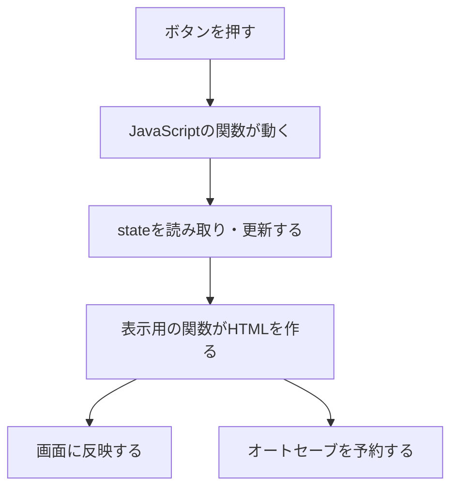

# JavaScript初心者向け：大学競泳監督シミュレーションのコード解説

**初めてJavaScriptを書く方は、先に[基礎の基礎：最初の1行から書いてみる](./JAVASCRIPT_FIRST_STEPS_JA.md)を読んでください。** 入力する場所、引用符や括弧の書き方から説明しています。[練習用HTML](./examples/javascript-first-steps.html)をダウンロードして、16個の小さな例を試せます。このファイルは、その後にゲームの実コードを読むための資料です。

このファイルは、このゲームのプログラムを初めて読む方向けの案内です。JavaScriptの基本を、実際の「選手」「練習」「レース」「セーブ」と結び付けて説明します。

**対象：このリポジトリのPWA v3.14のコード。作成日：2026年11月11日。** タイム・PBの説明は、現行のコードを参照しています。

最初に覚えることは、次の3つです。

1. `state` に、選手・年度・ポイントなどのゲームデータが入っている。
2. ボタンを押すと、JavaScriptの関数が呼ばれてデータを処理する。
3. データを画面に表示する処理と、保存する処理も用意されている。



本文の「実コード」はゲームからの抜粋です。関連する関数・データがあるゲーム内で動きます。「学習用」は仕組みを説明する小さな例で、ゲームの実装そのものではありません。

## 1. どのファイルに何が入っているか

| ファイル・場所 | 役割 | 読む順番の目安 |
| --- | --- | --- |
| [index.html](./index.html) の `<style>` 内 | CSS。文字の大きさ、色、画面の配置 | 画面を整えたいとき |
| `index.html` の `<body>` 内 | HTML。ボタンや表を置く画面の土台 | 最初に軽く見る |
| `index.html` の末尾側の大きな `<script>` 内 | JavaScript。育成・大会・記録・表示などのメイン処理 | この解説の中心 |
| [local-save.js](./local-save.js) | 端末のブラウザへ進行データを保存する | セーブの章の後 |
| [save-history.js](./save-history.js) | 保存容量を考慮して古い詳細戦績を整理する | 保存を詳しく調べたいとき |
| [cloud-sync.js](./cloud-sync.js) | 設定されたクラウドとセーブを同期する | クラウド保存を調べたいとき |
| [sw.js](./sw.js) | Service Worker。画面・プログラムのファイルをキャッシュする | オフライン動作の章 |
| [manifest.webmanifest](./manifest.webmanifest) | アプリ名、アイコン、起動時の表示などの設定 | インストール機能を調べたいとき |
| `tests/` | ゲームの処理や画面操作を確認するテスト | 一つの処理を理解した後 |

HTMLは「画面の部品」、CSSは「見た目」、JavaScriptは「処理」を担当します。このゲームでは、それらの多くが一つの `index.html` に入っています。

ファイルの先頭には実際の大会記録など、大きなデータのまとまりもあります。最初は数値を全部読む必要はありません。**関数名を検索して、知りたい処理から読む**と理解しやすくなります。

## 2. このコードを読むためのJavaScriptの基本

### 2-1. 変数：値に名前を付ける

学習用：

```js
const universityName = '関西青陵大学';
let points = 30;
points = points + 5;
```

- `const`：変数に別の値を代入し直さないときに使います。
- `let`：後で別の値を代入するときに使います。
- `=`：右側の値を左側の変数へ入れます。
- 最後の行で、`points` は35になります。

`const` でも、オブジェクトの中身を変更できる点には注意してください。

```js
const namedPlayer = { name: '水泳 太郎' };
namedPlayer.name = '水泳 次郎';
```

これは可能です。`namedPlayer` という変数を別のオブジェクトに置き換えているわけではありません。

### 2-2. オブジェクト：一人の選手をまとめる

学習用の簡略データ：

```js
const player = {
  id: 'sample-player',
  name: '水泳 太郎',
  year: 1,
  specialty: 'fr100',
  stats: { fr_speed: 120, fr_stamina: 110 },
  bestTimes: { fr100: 50.23, fr200: 107.45 }
};
```

`{ ... }` の中に、名前と値の組を並べたものが「オブジェクト」です。実際の選手には、ここで省略した能力や戦績なども入ります。

| 書き方 | 取り出す値 |
| --- | --- |
| `player.name` | 選手名 |
| `player.stats.fr_speed` | 自由形のスピード |
| `player.bestTimes.fr100` | 100m自由形のPB |
| `player.bestTimes[event]` | 変数 `event` で指定した種目のPB |

`event` が `'fr100'` なら、最後の2つは同じ値を取り出します。

`id` は選手を識別する値です。同姓同名の選手や、名前を変更した選手も区別できるよう、名前と別に持ちます。

タイムは、計算しやすいように**内部では秒の数値**で持ちます。上の200mの内部値は、画面では **1:47.45** と表示します。最初から `'1:47.45'` という文字列で保存しているわけではありません。

### 2-3. 配列：選手を一覧にする

`playerA`・`playerB`・`playerC` に、それぞれ一人分の選手オブジェクトが入っているとします。

```js
const players = [playerA, playerB, playerC];
```

`[ ... ]` は「配列」で、値を順番に入れる一覧です。配列の番号は0から始まります。

- `players[0]`：先頭の選手。
- `players.length`：選手の人数。
- `players.find(p => p.id === selectedId)`：指定したIDの選手を一人探す。
- `players.filter(p => p.year === 1)`：1年生だけを集めた新しい配列を作る。
- `players.map(p => p.name)`：選手の一覧から名前の一覧を作る。

`p => p.year === 1` は短い関数です。ここでは「渡された選手 `p` が1年生なら `true` を返す」という意味です。`===` は、値と型が一致しているかを比較します。

### 2-4. 関数：処理を名前で呼び出す

実コード：

```js
function expectedTime(p,e){
  return abilityBenchmarkTime(e,abilityValue(p,e)*200);
}
```

- `function expectedTime`：`expectedTime` という名前の関数を作る。
- `(p,e)`：選手 `p` と種目 `e` を受け取る。受け取る値を「引数」と呼ぶ。
- `return`：計算結果を、呼び出した場所へ返す。

`expectedTime(player, 'fr100')` と呼ぶと、その選手の100m自由形の基準タイムを受け取れます。この関数の中では、さらに別の関数を呼んでいます。**長い処理を、小さな関数に分けて組み合わせる**のが基本です。

### 2-5. 条件分岐と繰り返し

```js
if (player.year === 1) {
  // 1年生のときだけ行う処理
}

for (const player of players) {
  // 選手を一人ずつ取り出して行う処理
}
```

`if` は条件で処理を分け、`for...of` は一覧の要素を一つずつ処理します。`//` から後ろは、人が読むためのコメントです。

## 3. ゲーム全体を覚えている `state`

`index.html` には `let state;` という宣言があります。`state` は、ゲームの進行状態をまとめたオブジェクトです。

| 主な項目 | 入っている内容 |
| --- | --- |
| `state.season` | 現在の年度 |
| `state.slot` | 年度内の進行位置。1〜96 |
| `state.points` | 使用できるポイント |
| `state.reputation` | 操作大学の評判 |
| `state.players` | 自チームの現役選手 |
| `state.world` | 他大学・中高生・社会人などの選手 |
| `state.trainingFocus` | 選手ごとの練習指定 |
| `state.facilities` | 施設の状態 |
| `state.teamTop10` | 自チームの歴代10傑のデータ |
| `state.meetSession` | 進行中の大会・エントリーを再開するための情報 |
| `state.rngSeed` | 乱数の次の値を決めるための値 |

自チームの学年は主に `year`、CPU選手の学年は `grade`、中高生・大学生・社会人などの区分は `category` で扱います。同じ「選手」でも、役割によって使う項目が異なります。

年度の1か月は8区分で、週ごとに前半・後半があります。`slotDate()` が進行位置を月・週・前半／後半に読み替えます。

### 共通の設定データ

- `STATS`：基礎能力の名前。スタート、メンタル、各泳法のスピード・スタミナ・ターンの14項目。
- `EVENTS`：実施する15個人種目の識別子。
- `SPECIALTY_EVENTS`：専門種目として扱う12種目。
- `EVENT_LABEL`：`fr100` を `100mFr` のような表示名へ変換する対応表。
- `STANDARDS`：大会の参加標準。
- `MEETS`：開催時期と大会を対応させる予定表。

`fr` は自由形、`ba` は背泳ぎ、`br` は平泳ぎ、`fly` はバタフライ、`im` は個人メドレーです。例えば `br200` は200m平泳ぎを表します。

IMのスピード・スタミナは、4泳法の能力と選手固有の適性から求めます。`medleyStatValue()` が計算し、`attachMedleyStats()` が `stats.im_speed` などを読めるようにします。14項目の基礎能力とは扱いが異なります。

## 4. 起動するとき、何が動くか

`index.html` の末尾に、次の実コードがあります。

```js
initSelectors();
let startupSave=loadLocal();
if(startupSave?.then)startupSave.then(finishGameStartup);
else finishGameStartup(startupSave);
```

処理の順序は次のとおりです。

1. `initSelectors()` で選択欄などを準備する。
2. `loadLocal()` で端末のセーブを読み込む。
3. 読み込み結果を `finishGameStartup()` に渡す。
4. セーブがなければ `createState()` で新しいゲームデータを作る。
5. `renderAll()` で各画面を表示する。
6. 必要なら中断した大会や、新年度のお知らせを再開する。

`createState()` は、大学・選手・初期PB・記録表・育成目標などを組み立てる大きな関数です。CPU選手を作る部分には `makeAthlete()` があります。

保存データを読み込む経路では `applyLoadedSave()` が形式を確認し、`migrateState()` で現在のプログラムが使える形に整えます。新規開始時にも `migrateState()` を呼びます。例えば、必要な項目を補ったり、IMの計算用の仕組みを付け直したりします。

`?.` は「左側が `null` や `undefined` なら、その先を読まず `undefined` にする」という書き方です。`startupSave?.then` は、読み込みが完了待ちを伴う形かを調べています。

`.then(finishGameStartup)` は、読み込みが完了して結果が得られたら、`finishGameStartup` を呼ぶという指定です。

## 5. 「時間を進める」ボタンを追いかける

検索する文字は `getElementById("advanceBtn")` です。実際のクリック処理の流れを短くすると、次のようになります。

`onclick` に関数を入れると、そのボタンが押されたときの処理を登録できます。

```text
advanceBtn のクリック
  → 操作を進めてよい状態か確認
  → 進める前の日時と、その日時の大会を確認
  → trainCommand() で練習
  → advanceSlot() でカレンダーを進める
  → 大会がある場合は中断・再開用の状態を保存
  → renderAll() で画面を更新
  → 練習結果を見せる
  → 大会のエントリー画面や、お知らせを開く
```

ここでは、**大会の日付を先に覚えてから、カレンダーを次へ進める**のが重要です。ボタン内の `competitionSlot` と `competitionSeason` に、進める前の日時を残しています。

### 練習は `trainCommand()`

この関数の中心部分は、次のようになっています。実コードの一部を抜粋しています。

```js
for(let p of state.players){
  const gains=applyPlayerTraining(p,{camp});
  if(gains.changes.length)growth.push(gains);
}

for(let a of state.world){
  if(a.retired)continue;
  applyCpuTraining(a,collegePlan.get(a.id));
}
```

上のループは自チーム、下のループはCPU選手を処理します。`continue` は、その選手の残りの処理を飛ばして次の選手へ進む命令です。引退したCPU選手は練習処理を飛ばします。

| 関数 | 担当 |
| --- | --- |
| `applyPlayerTraining()` | 自チームの指定した練習による成長 |
| `statGrowthMultiplier()` | 能力が高くなるにつれて変わる成長倍率 |
| `cpuCollegeTrainingPlan()` | CPU大学生の専門種目、ランキング、リレーの役割を踏まえた練習種目 |
| `ensureCpuDevelopment()` | CPU選手の育成目標・成長を制限する条件を準備 |
| `applyCpuTraining()` | CPU選手を目標や成長型などに沿って成長させる |
| `measureCpuTrainingPBs()` | 毎月のCPU記録会でタイムを算出し、PB更新を判定 |

練習で能力が上がる処理と、タイムを計測してPBを更新する処理は区別されています。毎回の練習だけで、すべてのPBを書き換える仕組みではありません。

### カレンダーは `advanceSlot()`

実コードを改行して示します。

```js
function advanceSlot(){
  if(state.slot%8===0)processScoutingMonth();
  state.slot++;
  if(state.slot>96)newSeason();
}
```

`%` は割り算の余りです。`slot % 8 === 0` なら8区分ごとの月の区切りです。`++` は値を1増やします。96を超えると `newSeason()` で進級・卒業・進学などの年度更新へ進みます。

## 6. 能力からタイムを計算する

個人種目の基本的なつながりは次のとおりです。

```text
選手の能力・種目
  → eventProfile() で使う能力を取り出す
  → abilityValue() で種目に応じてまとめる
  → abilityBenchmarkTime() で能力を基準タイムへ読み替える
  → expectedTime() が基準タイムを返す
  → 調子補正とレース乱数を加える
```

50mと400mでは、スピード・スタミナなどの重みが異なります。`abilityValue()` がその違いを扱います。`abilityBenchmarkTime()` は、能力とタイムの基準点の間を計算してタイムを求めます。単に「能力が1上がるたび、常に同じ秒数だけ速くなる」という計算ではありません。

### 実際に使うタイムの基本形

実コード：

```js
function raceTarget(p,e,champ=true){
  const {base,formCorrection,raceCorrection}=raceTimeCorrections(p,e);
  return Math.max(1,base+formCorrection+raceCorrection);
}
```

| 値 | 意味 |
| --- | --- |
| `base` | 能力から求めた基準タイム |
| `formCorrection` | 調子による補正 |
| `raceCorrection` | そのレースごとのぶれ |

`const { ... } = ...` は、返ってきたオブジェクトの中から、必要な項目を取り出す書き方です。補正値がマイナスなら、足した結果のタイムは速くなります。`Math.max(1, ...)` は、計算結果が1秒より小さくならないようにしています。

引数の `champ=true` は、省略時の値を定める書き方です。この関数の現行の本体では、`champ` を計算に使っていません。

メンタルは、基準タイムへの直接の重みには入りません。`athleteMeetForm()` などを通じ、調子の出方に関係します。

### 初回PB・毎月の記録会・実レース

- `initialPersonalBest()`：初回用の大会状況を設定して、`raceTarget()` を呼ぶ。
- `coherentCpuPB()`：初回計測や不足PBの補完などに使う、再現可能な計測。呼び出し元で使用する通常の乱数列を保持する。
- `measureCpuTrainingPBs()`：その月の記録会の状況を設定し、`raceTarget()` で計測する。
- `simulateRace()`：同じタイム補正の仕組みを使い、レース結果・ラップ・再生用の位置情報などを組み立てる。

予選には追加の補正判定があります。リレーでは調子補正や引き継ぎの扱いも加わります。そのため「共通の基本計算を使う」ことと、「あらゆる大会・泳順の条件が同じ」ことは区別して読みます。

### 乱数もデータとして管理する

このゲームの `rng()` は、`state.rngSeed` から次の値を計算し、種を更新します。そのため、同じ乱数処理を同じ順序で呼べば、同じ値の並びを再現できます。

`coherentCpuPB()` などは、一時的に別の種を使い、`try...finally` で元の種に戻します。記録補完のための計測が、次の通常レースやスカウトの乱数の並びを変えないための工夫です。`finally` の部分は、途中でエラーが起きた場合も実行されます。

## 7. PBは、どうやって更新するか

実コード：

```js
function updatePersonalBest(a,event,time){
  if(!EVENTS.includes(event)||!Number.isFinite(time)||time<=0)return false;
  const next=round2(time);if(next<=0)return false;
  if(!a.bestTimes)a.bestTimes={};
  const previous=a.bestTimes[event];
  if(Number.isFinite(previous)&&previous>0&&previous<=next)return false;
  a.bestTimes[event]=next;
  if(a.standardAchievementVersion===1){
    if(!a.standardAchievements)a.standardAchievements={};
    a.standardAchievements[event]=[...new Set([...(a.standardAchievements[event]||[]),...standardsCleared(event,next)])];
  }
  return true;
}
```

上から順に読みます。

1. 対象種目か、タイムが有効な正の数か確認する。
2. `round2()` で小数点以下2桁に丸める。
3. PBの入れ物がなければ用意する。
4. すでに同じか速いPBがあるなら、書き換えず `false` を返す。
5. 新しいPBを保存する。
6. 標準突破の管理が有効なら、その情報にも反映する。
7. 更新できたことを示す `true` を返す。

ここでの `!` は否定、`||` は「または」、`&&` は「かつ」です。`includes()` は一覧に含まれるか、`Number.isFinite()` は有限の数値かを調べます。

`new Set(...)` は重複を除いた値の集まりを作ります。ここでは、同じ標準突破の種類を重複して登録しないために使っています。

PBの保存だけで、大会結果のすべてが処理されるわけではありません。レース後の `updateResultHistory()` は、PB判定・標準突破・保存対象の戦績・記録表などへ結果をつなぎます。`recordIndividualResult()` も個人記録の保存に関わります。

### タイムを画面用にする `fmt()`

実コード：

```js
function fmt(sec){
  if(sec==null||!Number.isFinite(+sec)||+sec<0)return "-";
  const hundredths=Math.round(+sec*100),minutes=Math.floor(hundredths/6000),seconds=((hundredths%6000)/100).toFixed(2);
  return minutes?`${minutes}:${seconds.padStart(5,"0")}`:seconds;
}
```

100分の1秒の整数に丸めてから、分と残りの秒に分けています。`padStart()` は必要な桁を0で埋める処理です。例えば `fmt(107.45)` の表示結果は **1:47.45**、`fmt(50.23)` は **50.23** です。

## 8. 大会・記録・スカウトは、どこを読むか

### 大会の処理

```text
openMeetEntry()：エントリー画面
  → executeMeet()：大会の計算を開始
  → runEvent()・runRelays()：各種目とリレー
  → simulateRace()・simulateRelay()：泳いだ結果を計算
  → updateResultHistory() など：PB・戦績・記録へ反映
```

`playMeetSequence()` は大会の再生・表示の進行、`playRaceCanvas()` は泳ぐ画面の描画、`showMeetResults()` は結果の表示に関係します。中断と再開のために計算結果や進行位置も保持しているので、上の流れが再開時に必ず最初から実行されるわけではありません。

`beginMeetSession()`、`saveMeetCheckpoint()`、`resumeMeetSession()` を読むと、大会・エントリーを閉じた後の再開処理を追えます。

### PBと歴代記録

| データ・関数 | 役割 |
| --- | --- |
| 選手の `bestTimes` | その選手の種目別PB |
| 選手の `raceHistory` | 保存対象となる選手の詳しい戦績 |
| `state.recordRankings` | 高校・学生・日本の歴代記録 |
| `state.teamTop10` | 自チームの歴代10傑 |
| `registerTeamPersonalBests()` | 入学時PBなどを自チームの記録に登録 |
| `storeTeamTop10Record()` | 同じ選手やリレーメンバーの速い記録を保ち、上位10件へ整理 |
| `recordRelayResult()` | リレー結果や第1泳者の個人記録を扱う |

同じ選手のPB、現在のランキング、過去年度を含む歴代記録は、目的が異なるデータです。選手が卒業しても、歴代記録を消す必要はありません。

### スカウト

`refreshScoutBoard()` は、候補を集めて整理する入口です。接触・申し出・競合・内定などは、`scoutingContact()`、`scoutingOffer()`、`processScoutingMonth()`、`processScoutingDecisions()` を読むと追えます。

名前だけを見ると「候補一覧を表示する処理」に見えても、その前にPBや候補の状態を確認する処理が入ることがあります。関数名だけで決めず、**何を読んで、何を書き換えて、何を返すか**を確認するのが読み方の基本です。

## 9. データを画面に表示する

`renderAll()` は、各画面用の `render...()` 関数を呼び、最後にオートセーブを予約します。

例えば `renderRoster()` は選手一覧、`renderStatus()` は年度やポイント、`renderScout()` はスカウト画面を担当します。

学習用に簡略化した表示処理：

```js
document.getElementById('rosterTable').innerHTML =
  state.players.map(p => `<p>${esc(p.name)}</p>`).join('');
```

1. `document` は、ブラウザに表示しているHTMLを扱う入口。
2. `getElementById()` で、指定IDを持つ画面の部品を探す。
3. `map()` で、選手ごとのHTML文字列を作る。
4. `join('')` で、それらを一つの文字列につなぐ。
5. `innerHTML` に入れると、その場所の表示が変わる。

バッククォートで囲んだ文字列の `${...}` には、計算結果や変数を埋め込めます。`esc()` は、名前などに含まれる記号をHTMLへ安全に表示できる形にします。実際の一覧は表やボタン、並び替えの処理を組み合わせています。

### 配列のコピーは、どこまでコピーされるか

`renderRoster()` には `let rows=[...state.players];` があります。`...` をこのように使うと、選手が並ぶ配列をコピーできます。表示用の配列を並び替えるときに使います。

ただし、**中の選手オブジェクトまで別物になるわけではありません。** `rows[0].name` を変更すると、元の同じ選手の名前も変わります。この違いを「浅いコピー」と呼びます。独立したデータが必要な場面では、`deepClone()` など別の方法を使います。

## 10. 保存とPWAを理解する

### ゲームの進行データを保存する

```text
saveLocal() またはオートセーブ
  → writeSaveSilently()
  → 必要なら古い詳細戦績の整理案を作る
  → local-save.js の保存処理
  → 保存できたことを確認して、日時や表示を更新する
```

`local-save.js` は、通常は `localStorage`、保存容量などの事情がある場合は `IndexedDB` を使います。どちらもブラウザ側の保存機能です。

`JSON.stringify(state)` は、オブジェクトをJSONという文字列の形式に変換します。`JSON.parse(text)` は、JSON文字列をJavaScriptのデータに戻します。関数や計算用の仕組みはJSONからそのまま復元できないため、読み込み後の `migrateState()` などで整えます。

`async` と `await` は、保存など完了まで待つ必要がある処理で使います。例えば `saveLocal()` は、`await writeSaveSilently('manual')` の結果を受け取ってから成功・失敗を表示します。

クラウド同期は `cloud-sync.js` が担当します。利用には設定が必要で、説明は [CLOUD_SYNC_SETUP.md](./CLOUD_SYNC_SETUP.md) にあります。

### PWAのファイルを保存する

`sw.js` は、画面やJavaScript、アイコンなどをブラウザのキャッシュに置きます。これによって、準備済みのファイルをオフラインでも利用できます。

ゲーム進行のセーブと、アプリのファイルのキャッシュは保存する対象が異なります。`manifest.webmanifest` は、アプリ名・アイコン・起動時の表示などの情報です。

GitHubにはプログラムのファイル一式があります。一方、ふつうのプレイ中の進行データは各端末のブラウザに保存され、クラウド同期を使うと設定された同期先にも保存されます。GitHubからコードをダウンロードすることと、自分のセーブを書き出すことは別の操作です。

## 11. 最初に読む関数の順番

エディタで `index.html` を開き、検索機能で次の名前を順に探してみてください。行番号は更新で変わるため、関数名で探す方法が便利です。

| 順番 | 検索する文字 | 読み取ること |
| --- | --- | --- |
| 1 | `function fmt` | 引数・計算・戻り値の基本 |
| 2 | `function updatePersonalBest` | 条件分岐でデータを更新する方法 |
| 3 | `function expectedTime` | 関数を組み合わせる方法 |
| 4 | `function raceTarget` | 基準タイムと補正の関係 |
| 5 | `function trainCommand` | 配列の選手を一人ずつ処理する方法 |
| 6 | `advanceBtn` | クリックから処理につながる入口 |
| 7 | `function renderRoster` | データから表示用HTMLを作る方法 |
| 8 | `function createState` | ゲーム全体のデータを準備する方法 |
| 9 | `function saveLocal` | 保存の完了を待ち、結果を表示する方法 |
| 10 | `function migrateState` | 読み込んだデータを使える形へ整える方法 |

一度に全部を理解する必要はありません。一つの関数について、次の3点をメモすると追いやすくなります。

- 入ってくる値は何か。
- どのデータを読み取り、どのデータを書き換えるか。
- 結果として何を返すか。

## 12. ゲームを変更せずにできる小さな練習

以下は単独で試せる学習用の例です。ゲーム本体の `state` を使いません。

```js
const samplePlayers = [
  { name: '水泳 太郎', year: 1, bestTimes: { fr100: 52.34 } },
  { name: '水泳 次郎', year: 2, bestTimes: { fr100: 50.12 } },
  { name: '水泳 三郎', year: 1, bestTimes: { fr100: 53.45 } }
];

const freshmen = samplePlayers.filter(p => p.year === 1);
const names = freshmen.map(p => p.name);

console.log(names);
// ['水泳 太郎', '水泳 三郎']
```

この例を理解できたら、次を試してみてください。

1. `year === 1` を `year === 2` に変える。
2. `map()` で名前の代わりに `p.bestTimes.fr100` を取り出す。
3. `filter()` の条件を `p.bestTimes.fr100 < 53` に変える。

「一覧から条件に合う選手を選ぶ」「必要な情報だけ取り出す」という処理は、実際の選手一覧・エントリー・ランキングにも繰り返し登場します。

## 用語の早見表

| 用語 | このゲームでの読み方 |
| --- | --- |
| 変数 | 年度やポイントなど、値に付けた名前 |
| オブジェクト | 一人の選手やゲーム全体など、項目をまとめたデータ |
| 配列 | 選手・種目・戦績などの一覧 |
| 関数 | 名前を付けて呼び出せる処理 |
| 引数 | 関数に渡す値。選手や種目など |
| 戻り値 | 関数が返す結果。タイムや更新の成否など |
| 条件分岐 | 条件を満たす場合だけ処理すること |
| イベント | クリックなど、操作や出来事の通知。競泳種目の `event` とは文脈で区別 |
| DOM | JavaScriptから操作するHTMLの構造 |
| 描画・render | データを画面の表示に反映すること |
| JSON | 保存や受け渡しに使うデータの文字列表現 |
| 非同期処理 | 保存や通信など、完了を待つ仕組みを伴う処理 |
| seed・乱数の種 | 次の乱数を決め、同じ計算を再現するための値 |
| migration | 保存データを現在のプログラムで使える形に整える処理 |
| PB | Personal Best。選手の自己ベスト |
| PWA | ブラウザのアプリをインストール・オフライン利用などに対応させる仕組み |

関連資料：[README](./README.md)、[v2.95の検証結果と残件](./REGRESSION_AUDIT_V295.md)。
